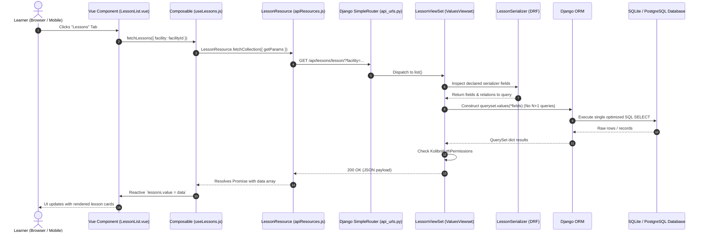

# Kolibri Full-Stack Development Workflow

A definitive architectural guide, developer manual, and runbook for building features across the **Frontend**, **Backend**, and **Database** layers of Kolibri.

---

## Table of Contents
1. [Architectural Overview & End-to-End Data Flow](#1-architectural-overview--end-to-end-data-flow)
2. [Quick Workflow Cheat Sheet](#2-quick-workflow-cheat-sheet)
3. [Deep Dive: Database Workflow](#3-deep-dive-database-workflow)
   - [Multi-Database SQLite Topology](#multi-database-sqlite-topology)
   - [PostgreSQL & Docker Lifecycle](#postgresql--docker-lifecycle)
   - [Dual Migration Requirement (Critical Dev Gotcha)](#dual-migration-requirement-critical-dev-gotcha)
   - [Seeding Development & Test Data](#seeding-development--test-data)
   - [Morango Decentralized Synchronization Engine](#morango-decentralized-synchronization-engine)
4. [Deep Dive: Backend Development Workflow](#4-deep-dive-backend-development-workflow)
   - [High-Performance ValuesViewset Pattern](#high-performance-valuesviewset-pattern)
   - [Model Conventions & Timestamps](#model-conventions--timestamps)
   - [Permissions & Role Hierarchy](#permissions--role-hierarchy)
   - [Interactive API Explorer & Django Silk Profiling](#interactive-api-explorer--django-silk-profiling)
   - [Writing Backend Unit & Integration Tests](#writing-backend-unit--integration-tests)
5. [Deep Dive: Frontend Development Workflow](#5-deep-dive-frontend-development-workflow)
   - [Vue 2.7 Composition API & Composables](#vue-27-composition-api--composables)
   - [Kolibri Design System (KDS) & Tokens](#kolibri-design-system-kds--tokens)
   - [Bublé Template Gotcha: No Optional Chaining in Vue Templates](#bublé-template-gotcha-no-optional-chaining-in-vue-templates)
   - [API Consumption via the Resource Layer](#api-consumption-via-the-resource-layer)
   - [i18n, RTL Flipping, and Responsive Design](#i18n-rtl-flipping-and-responsive-design)
   - [Frontend Unit Testing with Jest & Vue Testing Library](#frontend-unit-testing-with-jest--vue-testing-library)
6. [Dev Server Optimization & Multi-Device LAN Access](#6-dev-server-optimization--multi-device-lan-access)
   - [Scoped Plugin Bundling (`--watchonly`)](#scoped-plugin-bundling---watchonly)
   - [Local Network & Physical Device Testing](#local-network--physical-device-testing)
   - [Monorepo Tooling & Windows Build Configuration](#monorepo-tooling--windows-build-configuration)
7. [Quality Assurance, Linting & CI](#7-quality-assurance-linting--ci)
8. [Comprehensive Troubleshooting Guide](#8-comprehensive-troubleshooting-guide)

---

## 1. Architectural Overview & End-to-End Data Flow

Kolibri is an offline-first learning platform built to scale across extreme deployment constraints—from offline solar-powered Raspberry Pis and Android tablets to centralized state/national cloud clusters running PostgreSQL.

### Full-Stack Architecture Diagram

```mermaid
flowchart TD
    subgraph Frontend["Frontend Layer (Vue 2.7 + KDS)"]
        UI["Vue 2.7 Components (setup() + KDS)"]
        Composable["Vue Composables (Reactive State)"]
        ResourceLayer["Resource Client (kolibri/apiResource)"]
        UI -->|User Interactions / Read State| Composable
        Composable -->|Fetch / Mutate| ResourceLayer
    end

    subgraph Transport["Network / API Boundary"]
        HTTP["HTTP REST API (application/json)"]
        ResourceLayer -->|Async HTTP (XHR/Fetch)| HTTP
    end

    subgraph Backend["Backend Layer (Django REST Framework)"]
        Router["api_urls.py (SimpleRouter)"]
        ViewSet["ValuesViewset (kolibri.core.api)"]
        Serializer["DRF Serializer (Query Derivation)"]
        AuthPerm["KolibriAuthPermissions"]

        HTTP --> Router
        Router --> ViewSet
        ViewSet -.->|Derives values() query| Serializer
        ViewSet -.->|Enforces role-based rules| AuthPerm
    end

    subgraph Database["Database & Sync Layer"]
        DjangoORM["Django ORM (Models & QuerySets)"]
        Morango["Morango Engine (Sync Sessions)"]
        DBEngine{{"Engine Router"}}
        SQLite[("SQLite3 Multi-DB (Default Local)")]
        Postgres[("PostgreSQL 15 (Docker / Production)")]

        ViewSet --> DjangoORM
        DjangoORM --> DBEngine
        DBEngine --> SQLite
        DBEngine --> Postgres
        DjangoORM <--> Morango
        Morango <-->|Decentralized P2P Sync| PeerNodes["Peer Devices / Sync Hub"]
    end
```

### End-to-End Request-Response Sequence Flow

Here is the exact lifecycle of an end-to-end data operation (e.g., loading assigned lessons for a learner):



---

## 2. Quick Workflow Cheat Sheet

Unified workflow commands are provided through `scripts/workflow.ps1` (PowerShell on Windows) and `scripts/workflow.sh` (POSIX Bash on Linux/macOS/WSL), with matching `package.json` pnpm script aliases:

| Action | PowerShell (Windows) | Bash (Linux / macOS / WSL) | npm / pnpm Shortcut |
| :--- | :--- | :--- | :--- |
| **Workspace Setup** | `.\scripts\workflow.ps1 setup` | `./scripts/workflow.sh setup` | - |
| **Start Dev Server (All Plugins)** | `.\scripts\workflow.ps1 dev` | `./scripts/workflow.sh dev` | `pnpm devserver` |
| **Start Dev Server (Scoped Plugin)** | `.\scripts\workflow.ps1 dev -Plugin learn` | `./scripts/workflow.sh dev -p learn` | `pnpm devserver learn` |
| **Start with PostgreSQL** | `.\scripts\workflow.ps1 dev -Database postgres` | `./scripts/workflow.sh dev -d postgres` | - |
| **Run Core Migrations** | `.\scripts\workflow.ps1 db migrate` | `./scripts/workflow.sh db migrate` | `pnpm db:migrate` |
| **Run Dev/Silk Migrations** | `kolibri manage migrate --settings=kolibri.deployment.default.settings.dev` | `kolibri manage migrate --settings=kolibri.deployment.default.settings.dev` | `pnpm db:migrate:dev` |
| **Create Migrations** | `.\scripts\workflow.ps1 db makemigrations` | `./scripts/workflow.sh db makemigrations` | `pnpm db:makemigrations` |
| **Seed Test Data** | `.\scripts\workflow.ps1 db seed` | `./scripts/workflow.sh db seed` | `pnpm db:seed` |
| **Reset Database** | `.\scripts\workflow.ps1 db reset` | `./scripts/workflow.sh db reset` | - |
| **Check DB Status** | `.\scripts\workflow.ps1 db status` | `./scripts/workflow.sh db status` | - |
| **Switch DB Engine** | `.\scripts\workflow.ps1 db switch postgres` | `./scripts/workflow.sh db switch postgres` | - |
| **Run All Tests** | `.\scripts\workflow.ps1 test all` | `./scripts/workflow.sh test all` | `pnpm test:all` |
| **Run Backend Tests** | `.\scripts\workflow.ps1 test backend` | `./scripts/workflow.sh test backend` | `pnpm test:backend` |
| **Run Frontend Tests** | `.\scripts\workflow.ps1 test frontend` | `./scripts/workflow.sh test frontend` | `pnpm test:frontend` |
| **Run Pre-Commit Lint** | `.\scripts\workflow.ps1 lint` | `./scripts/workflow.sh lint` | `pnpm lint` |

---

## 3. Deep Dive: Database Workflow

Kolibri implements an adaptable database abstraction supporting offline single-user stations, multi-client LAN servers, and massive cloud deployments.

### Multi-Database SQLite Topology

In the default configuration, Kolibri maintains multiple dedicated SQLite databases inside the directory specified by `KOLIBRI_HOME` (default: `~/.kolibri/`):

| Database File | Alias in Django `DATABASES` | Purpose |
| :--- | :--- | :--- |
| `db.sqlite3` | `'default'` | Core models: user authentication, facilities, classrooms, lessons, exams, content metadata, Morango sync logs. |
| `notifications.sqlite3` | `'notifications'` | Real-time classroom events, student help requests, and coach notifications. Separated to eliminate write contention on the core database during heavy classroom activity. |
| `syncqueue.sqlite3` | `'syncqueue'` | Queues device-to-device and peer-to-peer sync requests. |
| `job_storage.sqlite3` | `'job_storage'` | SQLite-backed job queue for background workers (content downloads, exports, channel imports). |

> [!NOTE]
> Kolibri overrides standard SQLite connection handling with `BEGIN IMMEDIATE` transactions to prevent deadlocks and database-locked errors under concurrent multithreaded operations.

### PostgreSQL & Docker Lifecycle

For production deployments, institutional networks, or multi-user performance testing, PostgreSQL should be used. Kolibri provides a Docker Compose service on port `15432`:

```bash
# 1. Start the PostgreSQL container
docker compose up -d postgres

# 2. Check health status
docker compose ps postgres

# 3. Environment configuration
export KOLIBRI_DATABASE_ENGINE=postgres
export KOLIBRI_DATABASE_NAME=default
export KOLIBRI_DATABASE_USER=postgres
export KOLIBRI_DATABASE_PASSWORD=postgres
export KOLIBRI_DATABASE_HOST=127.0.0.1
export KOLIBRI_DATABASE_PORT=15432
```

Using the workflow CLI, this entire setup is automated:
```powershell
.\scripts\workflow.ps1 dev -Database postgres
```

### Dual Migration Requirement (Critical Dev Gotcha)

> [!CAUTION]
> **Why you must run two migration commands in development:**
>
> 1. `kolibri configure setup` (or `kolibri manage migrate`) uses the base settings (`kolibri.deployment.default.settings.base`). This creates tables for all core apps and plugins.
> 2. When running the dev server via `pnpm devserver` or `.\scripts\workflow.ps1 dev`, Kolibri runs under development settings (`kolibri.deployment.default.settings.dev`), which injects **Django Silk** query profiling middleware (`silk.middleware.SilkyMiddleware`).
> 3. If Silk's tables (`silk_request`, `silk_response`, `silk_sqlquery`) do not exist in the database, **every incoming HTTP request will crash with HTTP 500 (`django.db.utils.OperationalError: no such table: silk_request`)**!
>
> **The Fix:**
> Always run the development migrations after initializing or resetting a database:
> ```bash
> kolibri manage migrate --settings=kolibri.deployment.default.settings.dev
> ```
> *(This is automatically performed by `workflow.ps1 dev` and `workflow.ps1 db migrate`)*.

### Seeding Development & Test Data

#### 1. Synthetic Fast Seeding (`generateuserdata`)
Quickly generates facilities, classrooms, coaches, and synthetic learners with simulated activity:
```bash
# Generates 1 facility with 40 learners and active engagement records
kolibri manage generateuserdata --users 40 --classes 2 --facility "Demo School"
```
Or use the workflow shortcut:
```bash
pnpm db:seed
```

#### 2. Realistic QA Channel & Lessons Provisioning (`loadtest.py`)
To populate a complete environment with real educational content channels, superusers, and pre-assigned lessons:
```bash
# Ensure dev server is running on http://localhost:8000
cd integration_testing/load_testing
python loadtest.py --server http://localhost:8000 --username admin --password admin setup
```
This script:
1. Creates an administrative superuser (`admin` / `admin`).
2. Configures a facility named `Load Test Facility`.
3. Creates 10 learner accounts (`load_test_1` through `load_test_10`).
4. Imports the lightweight Kolibri QA channel token (`nakav-mafak`).
5. Assigns lessons and exercises across the classroom.

### Morango Decentralized Synchronization Engine

Kolibri uses **Morango**, an offline-first data synchronization engine designed for peer-to-peer data transfer without reliable internet:

```
[Device A: Tablet] <==== Ad-Hoc Wi-Fi / USB ====> [Device B: Local Server] <==== Internet ====> [Cloud Server]
```

- **UUID Keys**: All synchronized models inherit `morango.models.SyncableModel` and use deterministic UUIDs (`UUIDField`).
- **Certificate Chains**: Sync permissions are cryptographically verified using X.509 certificate chains rooted in facility datasets.
- **Fast-Forward & Merge**: Morango tracks changes via serialization buffers and vector clocks (`Store` and `Record` models), preventing write conflicts when multiple learners complete quizzes offline on separate tablets.

---

## 4. Deep Dive: Backend Development Workflow

Kolibri's backend is built on **Python 3.10+**, **Django**, and **Django REST Framework (DRF)**.

### High-Performance `ValuesViewset` Pattern

Standard DRF `ModelViewSet` instances often trigger severe performance degradation because serializers re-fetch nested related objects one-by-one (the N+1 query problem).

Kolibri mandates inheriting from `ValuesViewset` or `ReadOnlyValuesViewset` from `kolibri.core.api`:

```python
from rest_framework import serializers
from kolibri.core.api import ReadOnlyValuesViewset, ValuesViewset
from kolibri.core.auth.permissions import KolibriAuthPermissions
from .models import ClassroomResource

# 1. Define Serializer (Single source of truth for schema and fields)
class ClassroomResourceSerializer(serializers.ModelSerializer):
    class Meta:
        model = ClassroomResource
        fields = (
            "id",
            "title",
            "resource_id",
            "date_created",
        )

# 2. Define ViewSet inheriting from ReadOnlyValuesViewset
class ClassroomResourceViewSet(ReadOnlyValuesViewset):
    """
    ValuesViewset automatically inspects ClassroomResourceSerializer.Meta.fields
    and executes queryset.values(*fields). It bypasses ORM object instantiation,
    delivering 5x-10x throughput improvements.
    """
    serializer_class = ClassroomResourceSerializer
    queryset = ClassroomResource.objects.all()
    permission_classes = (KolibriAuthPermissions,)
    filter_backends = ()

    # Annotate computed fields directly into the SQL query when needed
    def annotate_queryset(self, queryset):
        return queryset.annotate(
            # e.g., total_views=Count('views')
        )
```

### Model Conventions & Timestamps

When defining models in Kolibri apps:

1. **Primary Keys**:
   ```python
   import morango.models
   class MyModel(morango.models.SyncableModel):
       id = morango.models.UUIDField(primary_key=True)
   ```
2. **Timestamps**:
   Always use `DateTimeTzField` from `kolibri.core.fields`. Standard Django `DateTimeField` can cause subtle timezone discrepancies across distributed nodes:
   ```python
   from kolibri.core.fields import DateTimeTzField
   date_modified = DateTimeTzField(auto_now=True)
   ```
3. **Deterministic Ordering**:
   Always declare `ordering` in model `Meta` to prevent erratic pagination under database engines:
   ```python
   class Meta:
       ordering = ("-date_modified",)
   ```

### Permissions & Role Hierarchy

Kolibri provides hierarchical role-based permissions (`KolibriAuthPermissions`):
- `Admin`: Full permissions across the facility.
- `Facility Coach`: Can review and assign lessons across all classes in the facility.
- `Class Coach`: Scoped permissions restricted to assigned classes.
- `Learner`: Read access to public content; write access strictly restricted to own interaction logs.

When checking permissions in custom services:
```python
from kolibri.core.auth.models import FacilityUser

user = request.user
if user.is_facility_admin(facility_id):
    # Perform administrative mutation
    pass
```

### Interactive API Explorer & Django Silk Profiling

Kolibri includes built-in interactive development endpoints:

1. **Swagger / OpenAPI UI**:
   - URL: `http://localhost:8000/api_explorer/`
   - Use: Explore all registered endpoints, query parameters, schemas, and execute live API calls.
2. **ReDoc Documentation**:
   - URL: `http://localhost:8000/redoc/`
3. **Django Silk Profiler**:
   - URL: `http://localhost:8000/profile/`
   - Use: Inspect exact SQL queries, identify duplicate database queries, measure request execution times, and detect N+1 queries.

### Writing Backend Unit & Integration Tests

Kolibri uses `pytest` and `pytest-django`:

```python
# test_classroom_resource.py
from django.urls import reverse
from rest_framework import status
from rest_framework.test import APITestCase
from kolibri.core.auth.test.helpers import create_facility_user

class ClassroomResourceApiTest(APITestCase):
    def setUp(self):
        self.user = create_facility_user("testuser", "password")
        self.client.force_login(self.user)

    def test_list_resources(self):
        url = reverse("kolibri:kolibri.core.classroom:classroomresource-list")
        response = self.client.get(url)
        self.assertEqual(response.status_code, status.HTTP_200_OK)
```

Run tests:
```bash
# Run tests for specific plugin
pytest kolibri/plugins/learn/test/
# Run matching test names
pytest -k "test_list_resources"
```

---

## 5. Deep Dive: Frontend Development Workflow

Kolibri's frontend is constructed with **Vue 2.7**, **Webpack 5**, and the **Kolibri Design System (KDS)**.

### Vue 2.7 Composition API & Composables

All new frontend features must follow the **Composition API** standard. The Options API and Vuex are strictly deprecated for new development:

```vue
<!-- LessonCard.vue -->
<template>
  <div class="lesson-card">
    <h3 class="title">{{ lesson && lesson.title }}</h3>
    <KButton
      :primary="true"
      :text="strings.startLesson$()"
      @click="onStart"
    />
  </div>
</template>

<script>
import { computed } from 'vue';
import { createTranslator } from 'kolibri/utils/i18n';
import KButton from 'kolibri-design-system/lib/buttons/KButton';

const strings = createTranslator('LessonCardStrings', {
  startLesson: {
    message: 'Start Lesson',
    context: 'Button label to open educational activity'
  }
});

export default {
  name: 'LessonCard',
  components: {
    KButton,
  },
  props: {
    lesson: {
      type: Object,
      required: true,
    },
  },
  setup(props, { emit }) {
    function onStart() {
      emit('start', props.lesson.id);
    }

    return {
      strings,
      onStart,
    };
  },
};
</script>

<style lang="scss" scoped>
.lesson-card {
  background-color: var(--tokens-surface);
  color: var(--tokens-text);
  padding: 16px;
  border-radius: 8px;
}
</style>
```

### Kolibri Design System (KDS) & Tokens

Always use existing KDS components. Never implement custom HTML buttons, modals, or inputs:

| Component | Import Path | Purpose |
| :--- | :--- | :--- |
| `KButton` | `kolibri-design-system/lib/buttons/KButton` | Accessible buttons with primary, flat, raised styles. |
| `KModal` | `kolibri-design-system/lib/KModal` | Accessible modal dialog with focus management. |
| `KCircularLoader` | `kolibri-design-system/lib/loaders/KCircularLoader` | Loading spinners. |
| `KTextbox` | `kolibri-design-system/lib/KTextbox` | Form inputs with validation messages. |
| `KCheckbox` | `kolibri-design-system/lib/KCheckbox` | Styled accessible checkboxes. |
| `KSelect` | `kolibri-design-system/lib/KSelect` | Dropdown selections. |
| `KEmptyPlaceholder` | `kolibri-design-system/lib/KEmptyPlaceholder` | Empty state cards with illustrations and CTAs. |

#### Design Tokens (CSS Variables)
Never hardcode hex values (`#fff`, `#212121`). Use design token CSS variables:
- `var(--tokens-surface)`: Background surfaces
- `var(--tokens-text)`: Primary text color
- `var(--tokens-annotation)`: Muted secondary text
- `var(--tokens-primary)`: Primary brand accent color
- `var(--tokens-error)`: Error state red

### Bublé Template Gotcha: No Optional Chaining in Vue Templates

> [!WARNING]
> **CRITICAL BUILD GOTCHA:**
> In Kolibri's Webpack pipeline, Vue single-file component `<script>` blocks are compiled through Babel (supporting modern ES2020+ syntax like `obj?.prop`), **BUT** `<template>` blocks are parsed and compiled via **Bublé** (an ES2015 compiler).
>
> If you write optional chaining (`?.`) or nullish coalescing (`??`) inside a `<template>` expression:
> ```html
> <!-- ❌ CRITICAL ERROR: Crashes webpack compilation with SyntaxError: Unexpected token . -->
> <p>{{ details?.author?.name }}</p>
> <div v-if="item?.children?.length">...</div>
> ```
>
> **The Rule:**
> Always use standard logical expressions or ternary operators in templates:
> ```html
> <!-- ✅ APPROVED PATTERNS -->
> <p>{{ details && details.author && details.author.name }}</p>
> <div v-if="item && item.children && item.children.length">...</div>
> ```

### API Consumption via the Resource Layer

Never use `fetch()` or `axios` directly in frontend components. Use Kolibri's `Resource` layer from `kolibri/apiResource`:

```javascript
// frontend/apiResources.js
import { Resource } from 'kolibri/apiResource';

export const LessonResource = new Resource({
  name: 'lesson', // Matches router registration in backend api_urls.py
});
```

Using in a Composable:
```javascript
// frontend/composables/useLessons.js
import { ref } from 'vue';
import { LessonResource } from '../apiResources';

export function useLessons() {
  const lessons = ref([]);
  const loading = ref(false);
  const error = ref(null);

  async function fetchLessons(params = {}) {
    loading.value = true;
    error.value = null;
    try {
      const data = await LessonResource.fetchCollection({
        getParams: params,
        force: true, // Bypass cached client state
      });
      lessons.value = data;
    } catch (err) {
      error.value = err;
    } finally {
      loading.value = false;
    }
  }

  return {
    lessons,
    loading,
    error,
    fetchLessons,
  };
}
```

### i18n, RTL Flipping, and Responsive Design

1. **Internationalization (i18n)**: All UI strings must be localized with `createTranslator`:
   ```javascript
   import { createTranslator } from 'kolibri/utils/i18n';
   const strings = createTranslator('MyScope', {
     greeting: { message: 'Welcome back!', context: 'Learner dashboard greeting' },
   });
   ```
2. **Right-to-Left (RTL) Layouts**:
   - Kolibri supports Arabic, Farsi, and other RTL languages.
   - Do **NOT** use inline CSS styles for directional properties (`style="margin-left: 10px"`). RTLCSS automatically inverts scoped `<style lang="scss">` blocks (`margin-left` becomes `margin-right` in RTL mode).
3. **Responsive Design without `@media` Queries**:
   - Because Kolibri can be embedded within windowed shells, iframes, and variable containers, do not use raw CSS `@media` queries.
   - Use `responsive-window` composable or `responsive-element` utilities to reactively bind layouts based on current element geometry.

### Frontend Unit Testing with Jest & Vue Testing Library

Tests are run using `@testing-library/vue` and Jest. Follow user-centric accessibility testing:

```javascript
import { render, screen, fireEvent } from '@testing-library/vue';
import LessonCard from '../LessonCard.vue';

describe('LessonCard', () => {
  it('renders lesson title and triggers start event on click', async () => {
    const lesson = { id: 'lesson-1', title: 'Fractions Intro' };
    const { emitted } = render(LessonCard, {
      props: { lesson },
    });

    expect(screen.getByText('Fractions Intro')).toBeInTheDocument();

    const startBtn = screen.getByRole('button', { name: /start lesson/i });
    await fireEvent.click(startBtn);

    expect(emitted().start).toBeTruthy();
    expect(emitted().start[0]).toEqual(['lesson-1']);
  });
});
```

Run tests:
```bash
pnpm test-jest kolibri/plugins/learn/
```

---

## 6. Dev Server Optimization & Multi-Device LAN Access

### Scoped Plugin Bundling (`--watchonly`)

Building the Webpack bundles for all 20+ Kolibri plugins can take several minutes and consume large amounts of memory. When developing, **scope the webpack watcher** to only the plugin you are actively changing:

```powershell
# Windows PowerShell
.\scripts\workflow.ps1 dev -Plugin learn

# POSIX Bash
./scripts/workflow.sh dev -p learn

# pnpm alias
pnpm devserver learn
```

To scope to multiple plugins:
```bash
pnpm devserver coach,facility
```

### Local Network & Physical Device Testing

The development server binds to `0.0.0.0:8000`, making it accessible across your local Wi-Fi or LAN network for testing on mobile phones, tablets, or other laptops:

```
Local Machine:    http://localhost:8000/
Local Network:    http://<YOUR_LAN_IP>:8000/   (e.g., http://10.18.136.137:8000/)
```

Find your local IP address:
- **Windows**: `ipconfig` (Look for `IPv4 Address`)
- **macOS / Linux**: `ip route get 1 | awk '{print $7}'` or `ifconfig`

### Monorepo Tooling & Windows Build Configuration

1. **Git Bash for npm Scripts on Windows**:
   Kolibri's `package.json` contains POSIX-style scripts with inline environment variables (`PYTHONPATH=. kolibri ...`). To ensure smooth execution on Windows without errors, `kolibri/.npmrc` is configured with:
   ```ini
   script-shell="C:\\Program Files\\Git\\bin\\bash.exe"
   ```
2. **Pnpm Dependency Hoisting**:
   Babel plugins and presets used across package boundaries require hoist rules in `.npmrc`:
   ```ini
   public-hoist-pattern[]=babel-plugin-polyfill-corejs3
   ```
3. **Python Virtual Environment**:
   Managed via `uv` at `kolibri/.venv`. All commands executed via `workflow.ps1` or `workflow.sh` automatically detect and activate this environment.

---

## 7. Quality Assurance, Linting & CI

Kolibri uses `prek` (a high-performance drop-in replacement for `pre-commit`) for linting, code formatting, and pre-commit checks.

### Standard Git Commit Workflow
```bash
# 1. Stage changes
git add .

# 2. Commit
git commit -m "feat(learn): implement lesson resource card"

# 3. If prek auto-formats or modifies files:
git status
git add .
git commit -m "feat(learn): implement lesson resource card"
```

### Running Linters Locally
```bash
# Lint staged files
prek run

# Lint a specific file
prek run --files kolibri/plugins/learn/frontend/views/LearnIndex.vue

# Lint entire branch diff
prek run --from-ref upstream/develop --to-ref HEAD
```

---

## 8. Comprehensive Troubleshooting Guide

| Issue / Symptom | Root Cause | Verified Solution |
| :--- | :--- | :--- |
| **HTTP 500: `no such table: silk_request`** | Django Silk middleware is enabled in dev settings, but Silk migrations were not run. | Run: `kolibri manage migrate --settings=kolibri.deployment.default.settings.dev`. |
| **Webpack compile error: `SyntaxError: Unexpected token .`** | Optional chaining (`?.`) was used in a `.vue` `<template>` block, unsupported by Bublé. | Replace `a?.b` with `a && a.b` or ternary expression in the template block. |
| **`'PYTHONPATH' is not recognized as an internal or external command`** | Windows `cmd.exe` executing POSIX npm scripts. | Ensure `script-shell="C:\\Program Files\\Git\\bin\\bash.exe"` is present in `kolibri/.npmrc`. |
| **`Cannot find module '@babel/preset-env'`** | Babel preset not resolvable from root pnpm workspace. | Presets wrapped with `require.resolve()` in `packages/kolibri-jest-config/jest.conf/babel.config.js`. |
| **Port 8000 or 15432 already in use** | A dangling Kolibri server or Docker container is already bound. | Run: `pnpm run clean` or `Get-Process python \| Stop-Process` on Windows. |
| **`sqlite3.OperationalError: database is locked`** | Concurrent processes accessing the same SQLite database file. | Terminate orphan `python` or `uv` background worker processes. |
| **Webpack Out of Memory / High CPU** | Compiling all 20+ plugins concurrently. | Use plugin scoping: `pnpm run devserver learn`. |
| **Missing translation string warning** | New strings created in UI without translation dictionary build. | Run `pnpm run makemessages`. |
| **Git commit fails with missing prek hook** | Pre-commit hooks not linked in `.git/hooks`. | Run `prek install`. |
| **Node Sass / C++ native binding mismatch** | Node.js version was changed after install. | Run `pnpm rebuild node-sass`. |
